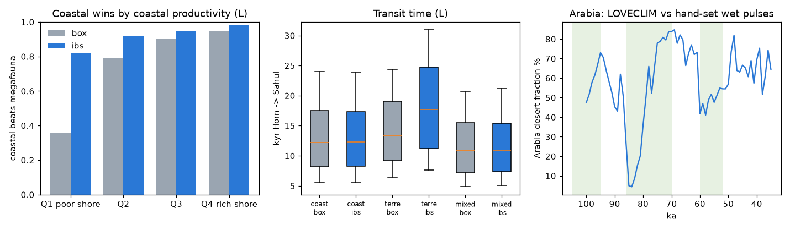

# LOVECLIM experiment: coast or herds with a real paleoclimate

## What changed

The original model took habitat from hand-drawn biome boxes, one Saharo-Arabian humidity index and one
monsoon index. This version takes habitat from a climate model. Per-cell, per-1-kyr net primary production,
desert fraction and temperature come from the LOVECLIM transient simulation behind Timmermann & Friedrich 2016
(*Nature*, doi:10.1038/nature19365), regridded from 1° to 20′. Big-game habitat is now
`0.02 + 0.88 · q_npp · q_dry · q_cold · (forest factor)`, and coastal fresh water during dry phases follows the
local desert fraction instead of a hand-set humidity pulse. Everything else about the machinery is untouched.

- Six new sampled parameters: `npp_ref` (NPP→habitat reference), `des_exp` (desert-fraction exponent),
  `t_min` (cold cut-off), `npp_forest`, `forest_pen`, and `cl_shift` (±2 kyr chronology shift of the climate series).
- Unchanged: sea level, coastlines, rivers, sea crossings, the re-tooling biome classes and the Dijkstra solver.
- Paired design: 400 long-chronology draws (Horn exit 72–85 ka) plus 400 short-chronology draws (Near East start
  47–51 ka). Every draw runs all three strategies — coastal, megafauna (terrestrial), mixed — on both climates with
  the same parameters and the same noise.
- The `box` runs reproduce the published results: all 36 shared columns match `results/monte_carlo_runs.csv` to
  floating-point precision (largest difference 7e-12). The new climate does not disturb the old one; it is a
  swap of the habitat input only.

## Headline results

- Long chronology: coastal beats megafauna in **0.75** of paired runs on the hand-drawn climate and **0.917** on
  LOVECLIM. The same strategy wins under both climates in **0.762** of draws.
- The deciding assumption changes. Hand-drawn climate, coastal win rate by coastal-productivity quartile:
  **[0.36, 0.79, 0.9, 0.95]**. LOVECLIM: **[0.82, 0.92, 0.95, 0.98]**. Shore richness no longer decides the race.
- What decides it now is exit timing and the Arabian desert. Only exits near the ~85 ka humid peak give herds a
  real chance: coastal win rate by exit-date quartile is **[1.0, 0.96, 0.93, 0.78]** from latest (~73 ka) to
  earliest (~85 ka) exit.
- Fit to the evidence (rejection ABC, Sulawesi by 67.8 ka, Sumatra by 63 ka, Nefud occupied by 70 ka): mixed is
  still the best fit. Strategy posterior, hand-drawn **0.233** coastal / **0.332** megafauna / **0.435** mixed;
  LOVECLIM **0.163** / **0.354** / **0.484**.
- Short chronology: coastal beats megafauna in **0.217** (hand-drawn) and **0.325** (LOVECLIM) of runs, same winner
  in **0.812**. Starting from the Near East after ~51 ka still favours herds, though LOVECLIM narrows the gap.
- Robustness: the coastal win rate stays at or above 0.8 in every quartile of all six new habitat parameters.



Left: coastal win rate by coastal-productivity quartile for both climates. Middle: Horn→Sahul transit-time
boxplots by strategy and climate. Right: LOVECLIM Arabian belt desert fraction against the hand-set humid pulses.

## Results in detail

### Head-to-head

On the long chronology, coastal transit from the Horn to Sahul is essentially unchanged by the new climate:
median **12.34** kyr under LOVECLIM versus **12.17** kyr on the hand-drawn climate, and it reaches Sahul in
1.0 and 0.985 of runs respectively. The megafauna front is what moves. It reaches Sahul in **0.885** of runs under
LOVECLIM (**0.993** hand-drawn) and its median Horn→Sahul transit stretches from **13.29** to **17.72** kyr. Median
Horn→India goes from 4.6 to **9.9** kyr, Horn→Sulawesi from 10.5 to **14.6** kyr. The coastal route is not
helped by LOVECLIM; the interior route is slowed down.

### What decides it now

Under LOVECLIM, interior Arabia and Iran are only briefly habitable for big-game hunters. The Arabian belt
desert fraction runs ~5 % at 85 ka, 36 % at 80 ka, 78–84 % at 75–70 ka, and 42–48 % at 60–55 ka. There is a
short window at the start, then a long hostile stretch. Herds that leave during the window can cross Arabia
quickly; herds that leave later have to wait for the partial greening around 60–55 ka or find a way round, which is
why the median transit grows and the Sahul reach rate falls.

Because the coastal route is insensitive to the climate, the coastal win rate becomes mainly a function of the exit
date rather than of the coast. Coastal win rate by exit-date quartile, earliest exit (~85 ka) first:
**0.78, 0.93, 0.96, 1.0**.

### Fit to the evidence (ABC)

The rejection filter is unchanged: Sulawesi reached by 67.8 ka, Sumatra by 63 ka, and the Nefud palaeolakes
occupied by 70 ka. Under LOVECLIM, **246** strategy-runs survive it (out of 3 strategies × 400 long-chronology
draws), against **572** on the hand-drawn climate — a real climate makes the evidence harder to satisfy. Posteriors: coastal **0.163**,
megafauna **0.354**, mixed **0.484** (hand-drawn: 0.233 / 0.332 / 0.435). Mixed remains the best fit, as before.

Pure coastal fits worse under LOVECLIM for a concrete reason: it rarely reaches the Nefud, in only **0.14** of
runs. The coast-only population cannot get inland inside LOVECLIM's short wet window, so it fails the Nefud
constraint that the hand-drawn humid pulses let it pass.

The posterior exit date also shifts earlier: `t0` = **[80.06, 82.95, 84.33]** ka under LOVECLIM against
**[75.39, 79.97, 83.84]** ka on the hand-drawn climate (10th, 50th and 90th percentiles). Front speed selects about
**3 km/yr** under both (posterior `v_max` median 3.0 against 3.14). Coastal productivity is not measured by the
evidence at all: its posterior stays on the prior under both climates. The coastal-productivity quartile result
above is therefore a statement about the model, not something the archaeological record can confirm.

### Timing vs Timmermann & Friedrich

Their published `arrivaltime` field is time since *last continuous settlement*, not first arrival, so it is not
comparable to ours and is not used. First arrival was instead read off their density snapshots (oldest 1-kyr
snapshot with density >0.01 per 100 km², scenario A, early exit).

Site *order* agrees well on the hand-drawn climate — Spearman 0.88–0.89 on 7 sites, with our arrivals lagging
after the South Arabian coast — and less well on LOVECLIM (0.46–0.83). Their South Arabia reference sits at the
start of their run (125 ka), so the cleaner comparison is the India→east leg: India→Sumatra / Sulawesi /
Madjedbebe takes 14 / 17 / 47 kyr in their scenario A (13 / 15 / 27 in B), against about 3 / 5 / 9 kyr in ours
across all strategies and both climates. The one exception is LOVECLIM coastal to Madjedbebe: 23 kyr, and
reached in only 0.45 of runs.

Our fronts are 3–5× faster because the evidence (Sulawesi art ≥ 67.8 ka) selects ~3 km/yr, while their diffusion
model spreads more slowly. That is not independent validation: both models use a LOVECLIM-family climate, so
agreement or disagreement is partly a shared-input effect.

## Robustness checks

The coastal win rate stays ≥ 0.8 in every quartile of all six new habitat parameters, so no single mapping choice
drives the LOVECLIM result. In the corner most favourable to herds — generous NPP mapping, `npp_ref` in the
lowest quartile and `des_exp` below the median — coastal still wins **0.76** (n = 51). When the shore is also poor
(`c_adv` < 0.85) in that corner it drops to **0.57**, but on 14 runs, which is too few to lean on.

One structural fix was needed. LOVECLIM leaves some small islands with almost no terrestrial production, which
would make them barriers rather than stepping stones on the megafauna route. An unresolved-island screen
(LOVECLIM cells with netpp < 0.15, desert < 30 %, temp ≥ 18 °C refilled from nearest land) touches 84 source
cells, including Nusa Tenggara, which is otherwise barren in LOVECLIM and blocks the southern route. This fix
matters: without it the megafauna front failed to reach Sahul in 8 of 9 pilot runs, purely because of the island
artifact. An earlier, over-broad version of the screen (1110 cells, including cold steppe) gave identical
aggregates, so the result is not sensitive to the cold-cell part of the cut.

## Caveats

LOVECLIM is a coarse intermediate-complexity model; its native resolution is far coarser than the 1° we regrid
from, so local coastal detail is a construction, not a model output. It is one simulation, not an ensemble, so
there is no climate uncertainty propagation. The re-tooling biome classes are still hand-drawn. The NPP→habitat
mapping is assumed, even though it is tested. The island screen is a judgement call. The 20′ grid still misses
narrow Red Sea and south Arabian shelves, which matters most precisely where the coastal strategy is supposed to
win. The IBS data are CC BY-NC: cite the dataset page
(https://climatedata.ibs.re.kr/data/human-dispersal-simulation) and doi:10.1038/nature19365.

## Files and how to re-run

In this directory:

- `summary_ibs.json` — every number quoted above (all three strategies, both chronologies, both climates, ABC,
  benchmark).
- `monte_carlo_runs_loveclim.csv` — the 800 draws, one row per draw, parameters and all arrival times.
- `mc_ibs.pkl` — the same draws as a pickled DataFrame (read with `pandas.read_pickle`).
- `density_ibs.npz` — per cell, how many runs used it on the fastest route to Sahul and how many had occupied it by
  the snapshot date (65 ka long, 45 ka short chronology), per climate and strategy; for maps (0.4 MB).
- `fig_ibs.png` — the figure above.
- `check_table.txt` — the 24-run gate check run before the full experiment. Its counts are a pilot (n = 24),
  not the 400-run results; use `summary_ibs.json` for numbers.
- `full.log`, `climate3.log`, `analyze.log` — run logs (progress, climate cache statistics, the full analysis
  dump).

To re-run from the project root:

```
mkdir work && cd work
python ../code/build.py
python ../code/climate_ibs.py
python ../code/mc_ibs.py 400
python ../code/analyze_ibs.py
```

This needs `data/external/ibs_hds/*.nc` and a Python environment with numpy, scipy, pandas, numba 0.68.1,
netCDF4 and matplotlib. It takes about 7 minutes on 8 cores.
